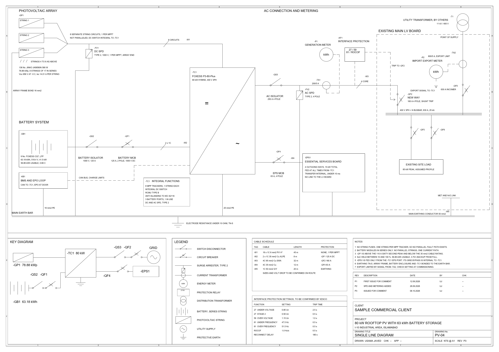
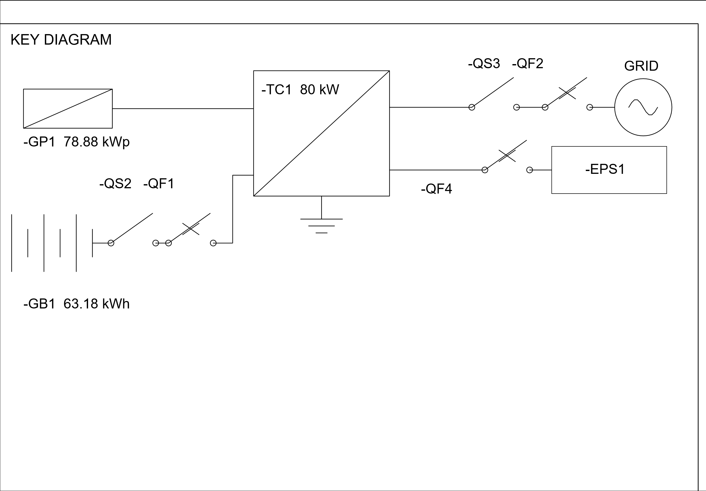
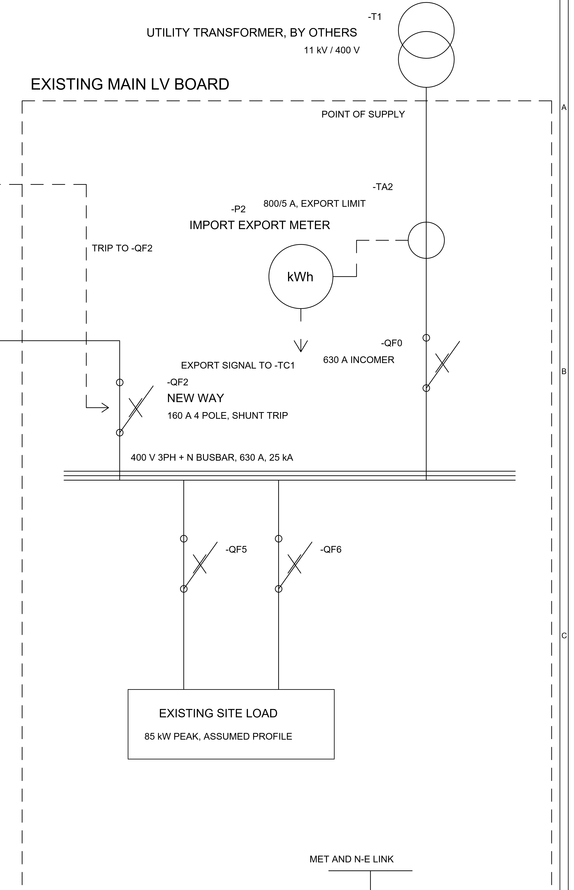
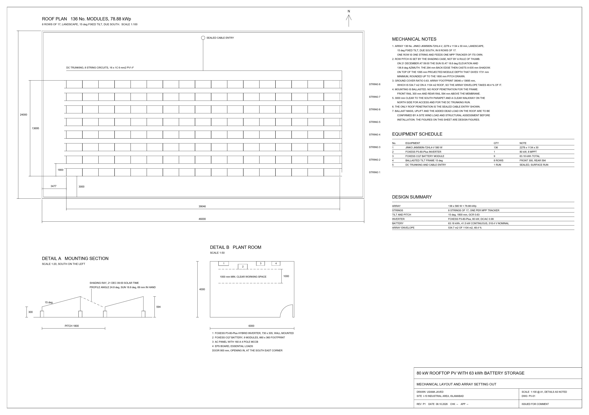
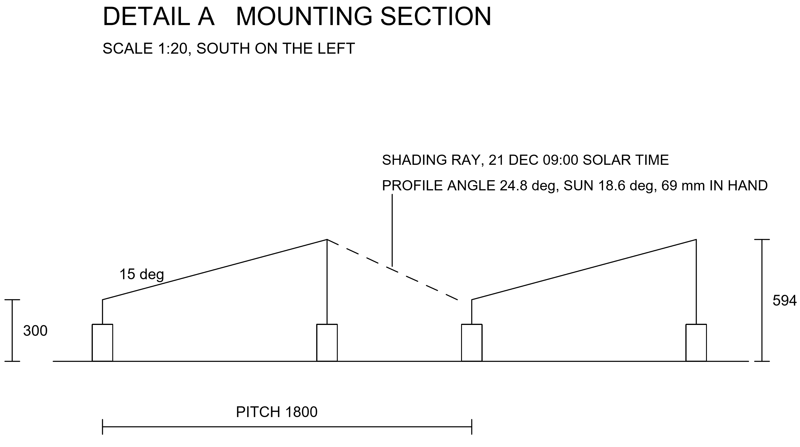
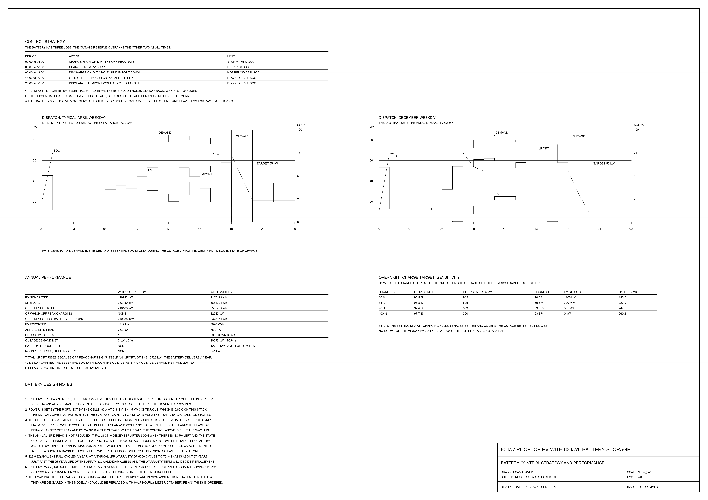
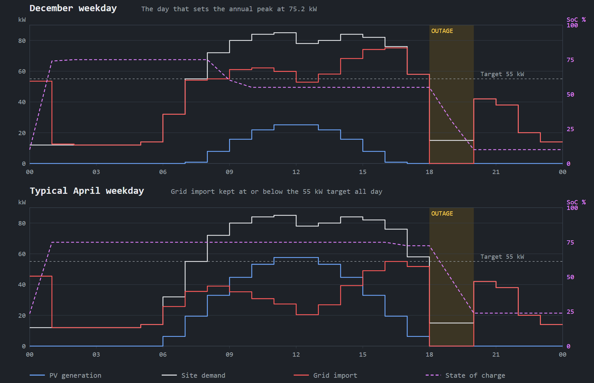

# 80 kW Commercial Rooftop PV with a 63 kWh Battery: AutoCAD Drawings and Python Dispatch Model

Live on portfolio: **[usamajaved.ie](https://usamajaved.ie/roles/project-engineering)**

An 80 kW rooftop PV system with battery storage for a commercial unit in Islamabad: 136 Jinko 580 W modules at **78.88 kWp** on a **FoxESS P3-80-Plus** hybrid inverter, with **nine FoxESS CQ7 modules** in series giving **63.18 kWh** at **518.4 V**.

Three A1 sheets drawn in AutoCAD 2027: the single line diagram (`PV-04`), the mechanical layout (`PV-01`) and the battery control and performance sheet (`PV-03`).

---

## Drawings Included (`drawings/`)

- **`PV-04 Single Line Diagram`** ([PDF](drawings/PV-04%20Single%20Line%20Diagram.pdf) · [DWG](drawings/PV-04%20Single%20Line%20Diagram.dwg) · [DXF](drawings/PV-04%20Single%20Line%20Diagram.dxf)): the whole A1 sheet at revision P3, issued for comment. Shows the eight string circuits, the battery and its DC protection, the hybrid inverter, metering and interface protection, the existing LV board and the point of supply, and the earthing, with the key diagram, legend, schedules, revisions and title block along the bottom.
- **`PV-01 Mechanical Layout`** ([PDF](drawings/PV-01%20Mechanical%20Layout.pdf) · [DWG](drawings/PV-01%20Mechanical%20Layout.dwg) · [DXF](drawings/PV-01%20Mechanical%20Layout.dxf)): the roof plan with eight rows of seventeen modules set out 3,000 mm clear of the south parapet at a 1,800 mm pitch, the mounting section (Detail A at 1:20 showing the 21 December 09:00 shading ray stopping 69 mm short of the next row), the plant room, notes, equipment schedule and design summary.
- **`PV-03 Battery Control and Performance`** ([PDF](drawings/PV-03%20Battery%20Control%20and%20Performance.pdf) · [DWG](drawings/PV-03%20Battery%20Control%20and%20Performance.dwg) · [DXF](drawings/PV-03%20Battery%20Control%20and%20Performance.dxf)): the control strategy, a typical April day and the December day that sets the annual peak, annual performance with and without the battery, and how the overnight charge target trades the battery's jobs against each other.

### Drawing Previews









---

## How the Battery Was Sized (`model/`)

The first thing the model said was that the battery was not worth fitting if charged only from surplus PV: it cycled about 13 times a year because the site load is **3.3 times** the generation and there is almost no surplus to store. The battery only earns its place if it is charged off peak and given the job of carrying the site through the daily outage.

Dispatch was modelled hour by hour for a year in plain Python (`model/dispatch.py`) with no external libraries, so every number can be traced by reading the file. Three jobs, in priority order:
1. Hold a reserve for the essential board through the evening outage.
2. Keep grid import under the 55 kW maximum demand target.
3. Soak up whatever PV would otherwise be exported.

### Control Strategy

| Period | Action | Limit |
|---|---|---|
| 00:00 to 05:00 | Charge from the grid at the off peak rate | Stop at 75% SoC |
| 06:00 to 18:00 | Charge from PV surplus | Up to 100% |
| 06:00 to 18:00 | Discharge only to hold grid import down | Not below 55% |
| 18:00 to 20:00 | Grid off, EPS board runs on PV and battery | Down to 10% |
| 20:00 to 06:00 | Discharge if import would exceed the target | Down to 10% |

### Annual Performance

| Over a year | Without battery | With battery |
|---|---|---|
| PV generated | 116,742 kWh | 116,742 kWh |
| Site load | 383,139 kWh | 383,139 kWh |
| Grid import, total | 240,188 kWh | 250,546 kWh |
| of which off peak charging | none | 12,649 kWh |
| Annual grid peak | 75.2 kW | 75.2 kW |
| Hours over the 55 kW target | 1,078 | 695, down 35.5% |
| Outage demand met | 0% | 96.8% |
| Battery throughput | none | 12,729 kWh, 223.9 full cycles |
| Round trip loss, battery only | none | 641 kWh |

Of the 12,729 kWh the battery delivers in a year, 10,438 kWh carries the essential board through the evening outage and 2,291 kWh cuts daytime import above the target. The 55% floor holds 1.9 hours of reserve against a 2 hour outage, so 96.8% of outage demand is met.

The annual peak does not move because it falls on a December afternoon when there is no PV left and the state of charge is pinned at the 55% floor that protects the 18:00 outage. Hours spent over the target fall by a third. Lowering the maximum as well needs a second CQ7 stack on port two, or an agreement to accept a shorter backup through the winter.

### Off-Peak Charge Target Sensitivity

| Off peak charge target | Outage met | Hours over 55 kW | PV stored | Cycles a year |
|---|---|---|---|---|
| 60% | 95.5% | 965 | 1,106 kWh | 193.5 |
| **75%, the one drawn** | **96.8%** | **695** | **720 kWh** | **223.9** |
| 90% | 97.4% | 503 | 305 kWh | 247.2 |
| 100% | 97.7% | 390 | none | 260.2 |

---

## Cable Schedule and Interface Protection (`PV-04`)

### Cable Schedule

| Tag | Cable | Length | Protection |
|---|---|---|---|
| W1 | 16 x 1C 6 mm2 PV1-F | 45 m | None, one string per MPPT |
| W2 | 2 x 1C 35 mm2 Cu XLPE | 8 m | QF1, 125 A DC, 2 pole |
| W3 | 4C 95 mm2 Cu SWA | 32 m | QF2, 160 A MCCB |
| W4 | 4C 35 mm2 Cu | 12 m | QF4, 63 A MCB |
| W5 | 1C 50 mm2 green/yellow | 20 m | Main earthing conductor |

### Interface Protection Settings

| Function | Setting | Trip time |
|---|---|---|
| 27 under voltage | 0.80 Un | 2.5 s |
| 27 stage 2 | 0.50 Un | 0.5 s |
| 59 over voltage | 1.15 Un | 1.0 s |
| 81 under frequency | 47.5 Hz | 0.5 s |
| 81 over frequency | 51.5 Hz | 0.5 s |
| ROCOF | 1.0 Hz/s | 0.5 s |
| Reconnect delay | After the grid returns | 180 s |

Lengths are design figures for this building. Cable sizes and volt drop are to be confirmed on the actual route, and the relay settings with IESCO, so `PV-04` stays at revision P3 until they are. Equipment figures come from the FoxESS P3 Plus and CQ7 datasheets and the Jinko 72HL4-V datasheet. The load profile, the outage window and the tariff periods are design assumptions declared at the top of the model.

---

## Running the Model

```bash
python model/design.py
python model/dispatch.py
```

---

## Related Solar PV Engineering, Planning and Analytics Projects by Usama Javed

- **Portfolio Website**: [usamajaved.ie](https://usamajaved.ie) ([Project Planner / Scheduler](https://usamajaved.ie/roles/planning) · [Solar Project / Technical Engineer](https://usamajaved.ie/roles/project-engineering) · [Site Supervisor / Field Delivery](https://usamajaved.ie/roles/site-delivery) · [Energy / Reporting Analyst](https://usamajaved.ie/roles/energy-analytics))
- **[80kw-pv-bess-autocad-dispatch](https://github.com/usamajaved1305/80kw-pv-bess-autocad-dispatch)**: 80 kW commercial rooftop PV and 63 kWh FoxESS battery storage in AutoCAD 2027 (A1 sheets PV-01, PV-03, PV-04) and 8,760-hour Python dispatch simulation
- **[115kwp-solar-energy-yield-python](https://github.com/usamajaved1305/115kwp-solar-energy-yield-python)**: 115 kWp commercial rooftop PV energy yield model in Python (Jupyter, pandas, matplotlib, PVGIS ERA5) and HelioScope simulation
- **[115kwp-solar-bom-cost-procurement](https://github.com/usamajaved1305/115kwp-solar-bom-cost-procurement)**: 115 kWp commercial rooftop PV BOM, string voltage verification, procurement tracker and cost control in Excel, SQLite and Power BI
- **[20kw-rooftop-pv-schedule-and-shading](https://github.com/usamajaved1305/20kw-rooftop-pv-schedule-and-shading)**: 20 kW residential rooftop PV installation programme (Primavera P6 and MS Project), OpenSolar proposal and SketchUp 3D ray-traced shading check
- **GitHub Profile**: [github.com/usamajaved1305](https://github.com/usamajaved1305) · **LinkedIn**: [linkedin.com/in/usama-javed-553b8624b](https://www.linkedin.com/in/usama-javed-553b8624b)
